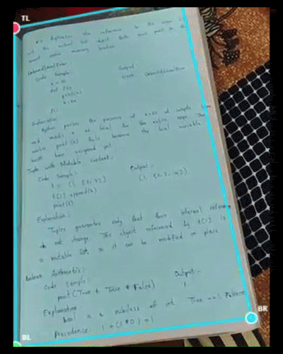
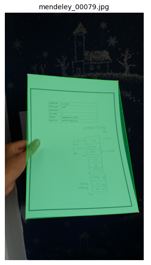
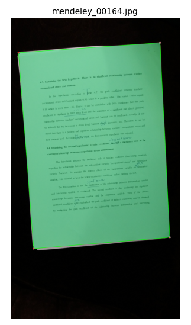

<div align="center">

# 📄 Document Corner Detection

**Real-time document corner detection for edge deployment using YOLOv8-seg.**
Detects exactly 4 document corners from live camera feeds or static images,
enabling perspective de-warping for high-quality mobile document scanning.

[](https://www.python.org/)
[](https://github.com/ultralytics/ultralytics)
[](LICENSE)
[](https://developer.android.com/)

</div>

---

## 🎬 Live Demo

<div align="center">



*Real-time corner tracking at inference speed using a local webcam.*

</div>

---

## 🖼️ Sample Predictions

<div align="center">

| Predicted Image 1 | Predicted Image 2 |
|:-:|:-:|
|  |  |

</div>

The model outputs a **dense segmentation mask** per document, then post-processes it into exactly **4 canonical corners** (TL → TR → BR → BL) using convex-hull approximation and adaptive `approxPolyDP` sweeping — no hardcoded epsilon needed.

---

## 📋 Table of Contents

1. [Project Overview](#-project-overview)
2. [Repository Structure](#-repository-structure)
3. [Google Colab (Alternative Workflow)](#-google-colab-alternative-workflow)
4. [Installation](#-installation)
5. [Complete Pipeline — Step by Step](#-complete-pipeline--step-by-step)
   - [Step 1 — Download Datasets](#step-1--download-datasets)
   - [Step 2 — Build YOLO Dataset](#step-2--build-yolo-dataset)
   - [Step 3 — Train](#step-3--train)
   - [Step 4 — Evaluate](#step-4--evaluate)
   - [Step 5 — Single-Image Inference](#step-5--single-image-inference)
   - [Step 6 — Live Webcam](#step-6--live-webcam)
   - [Step 7 — Export to TFLite](#step-7--export-to-tflite-android)
6. [Model Architecture & Post-Processing](#-model-architecture--post-processing)
7. [Dataset Acknowledgements](#-dataset-acknowledgements)
8. [Training Details](#-training-details)
9. [Project Roadmap](#-project-roadmap)

---

## 🔭 Project Overview

This project trains and deploys a **YOLOv8-nano segmentation** model tuned for document corner detection in real-world mobile captures. The design goals are:

| Goal | Approach |
|---|---|
| **Accuracy on real scans** | 7 datasets: flat docs, warped paper, clutter, extreme angles, receipts, synthetic |
| **Exact 4-corner output** | Convex hull → adaptive `approxPolyDP` sweep (90-step, 0.01–0.10 of perimeter) → canonical sort |
| **Android edge deployment** | TFLite FP16 and INT8 export; tested with Ultralytics Android runtime |
| **Perspective de-warping** | `src/postprocess.perspective_warp()` rectifies the quad for clean OCR input |
| **Fully local pipeline** | All Colab-specific code replaced with standard Python + OpenCV |

---

## 📁 Repository Structure

```text
document-corner-detection/
├── assets/                           ← Demo images and GIF captures
│   ├── manual-capture.gif            ← Live webcam demo animation
│   ├── manual-capture.jpg            ← Mobile capture sample
│   └── predicted-img-{1..8}.png      ← Validation set predictions
│
├── weights/                          ← Model checkpoints (not in Git — see .gitignore)
│   ├── .gitkeep                      ← Keeps the directory tracked by Git
│   ├── best.pt                       ← Best PyTorch checkpoint
│   ├── last.pt                       ← Last epoch checkpoint
│   ├── best.tflite                   ← FP16 Android model
│   └── best_int8.tflite              ← INT8 quantised Android model
│
├── src/                              ← Inference & utility library
│   ├── __init__.py
│   ├── postprocess.py                ← 4-corner geometry & perspective warp
│   ├── infer.py                      ← Single-image inference CLI
│   ├── webcam.py                     ← Local OpenCV webcam inference loop
│   └── export.py                     ← YOLO → TFLite export utility
│
├── data_prep/                        ← Dataset acquisition & formatting
│   ├── download_datasets.py          ← Stream/download all 7 source datasets
│   └── build_yolo_format.py          ← Assemble unified YOLO-seg dataset
│
├── training/                         ← Training & evaluation scripts
│   ├── train.py                      ← YOLOv8-seg training CLI
│   ├── test.py                       ← Evaluation: metrics + visual grid
│   └── dataset.yaml                  ← Dataset configuration (auto-updated)
│
├── Paper_Corner.ipynb                ← Original Google Colab notebook (reference)
├── DocScan_Training_Run/             ← Training logs and artefacts from Colab run
├── requirements.txt
├── .gitignore
└── README.md
```

---

## ☁️ Google Colab (Alternative Workflow)

> **Prefer to run everything in the cloud?** The original `Paper_Corner.ipynb` notebook is included in this repository and covers the complete pipeline end-to-end — dataset streaming, training, evaluation, and export — all within a single Colab session with free GPU access.

[](https://colab.research.google.com/github/smsram/document-corner-detection/blob/main/Paper_Corner.ipynb)

> [!NOTE]
> The Colab notebook uses Google-specific helpers (`google.colab.userdata`, JavaScript webcam bridges) that do not work locally. All local scripts in `src/`, `data_prep/`, and `training/` are self-contained replacements.

---

## ⚙️ Installation

### Prerequisites

- Python **3.10 or higher**
- pip ≥ 23
- *(Optional for training/evaluation)* CUDA-enabled GPU

### 1. Clone the repository

```bash
git clone https://github.com/smsram/document-corner-detection.git
cd document-corner-detection
```

### 2. Create and activate a virtual environment

```bash
# Windows (PowerShell)
python -m venv .venv
.venv\Scripts\Activate.ps1

# macOS / Linux
python -m venv .venv
source .venv/bin/activate
```

### 3. Install all dependencies

```bash
pip install -r requirements.txt
```

### 4. Set your Hugging Face token

Several datasets (Doc3D, DocLayNet) are hosted on gated Hugging Face repositories and require authentication.

1. Create a free account at [huggingface.co](https://huggingface.co/) and visit [huggingface.co/settings/tokens](https://huggingface.co/settings/tokens) to generate an **Access Token**.
2. Export it as an environment variable **before** running any download scripts:

```bash
# Linux / macOS
export HF_TOKEN="hf_your_token_here"

# Windows CMD
set HF_TOKEN=hf_your_token_here

# Windows PowerShell
$env:HF_TOKEN = "hf_your_token_here"
```

> [!TIP]
> Add `HF_TOKEN=hf_...` to a `.env` file in the repo root (it is gitignored). Load it with `python-dotenv` or `source .env` so you never have to set it again.

> [!IMPORTANT]
> Never commit your token to version control. The `.gitignore` excludes `.env` and `secrets.*` files automatically.

---

## 🚀 Complete Pipeline — Step by Step

Run the commands below **in order** from the repository root.

---

### Step 1 — Download Datasets

```bash
python data_prep/download_datasets.py
```

Downloads all 7 source datasets into `raw_datasets/`. This will take some time depending on your connection (~3–5 GB total).

**Download specific datasets only:**

```bash
python data_prep/download_datasets.py --datasets doc_corner cord mendeley
```

Available dataset keys: `doc_corner`, `cord`, `doclaynet`, `doc3d`, `midv500`, `smartdoc15`, `mendeley`

**Custom output directory:**

```bash
python data_prep/download_datasets.py --out-dir /data/raw_datasets
```

> [!NOTE]
> `HF_TOKEN` must be set before running this step if you need `doc3d` or `doclaynet`.

---

### Step 2 — Build YOLO Dataset

```bash
python data_prep/build_yolo_format.py
```

Reads every raw dataset, converts all annotation formats to normalised YOLO-seg polygon labels, generates 1 300 synthetic edge-case images, and writes the final `yolo_dataset/`. Also auto-updates `training/dataset.yaml` with the correct path.

**Options:**

```bash
python data_prep/build_yolo_format.py \
    --raw-dir raw_datasets \
    --out-dir yolo_dataset \
    --syn-count 1300
```

**Expected output:**

```
[Train]  DocCorner          ~2 000 images
[Train]  Doc3D              ~1 500 images
[Train]  MIDV-500             ~400 images
[Train]  SmartDoc              ~30 images
[Train]  CORD-v2              ~800 images
[Train]  Synthetic          ~1 300 images
[Val  ]  Mendeley (Val)     ~1 100 images
```

---

### Step 3 — Train

```bash
python training/train.py --data training/dataset.yaml
```

**Common options:**

```
--model       YOLOv8 variant        [default: yolov8n-seg.pt]
--epochs      Training epochs       [default: 50]
--batch       Mini-batch size       [default: 16]
--imgsz       Image resolution      [default: 640]
--device      "0" (GPU) or "cpu"    [default: "0"]
--resume      Resume interrupted run
--export      Export best.pt to TFLite after training
```

**Example — CPU training with auto-export:**

```bash
python training/train.py \
    --data training/dataset.yaml \
    --epochs 100 \
    --batch 4 \
    --device cpu \
    --export
```

Best weights are automatically copied to `weights/best.pt` after training.

---

### Step 4 — Evaluate

```bash
python training/test.py --data training/dataset.yaml
```

Runs the Ultralytics validation pipeline on the held-out Mendeley benchmark and prints Mask/Box mAP50 and mAP50-95 metrics. Saves a `metrics.json` to `runs/eval/`.

**Generate a visual prediction grid:**

```bash
python training/test.py \
    --data training/dataset.yaml \
    --visualise \
    --vis-dir assets/ \
    --vis-count 8
```

**All options:**

```
--weights     Path to .pt checkpoint                 [default: weights/best.pt]
--data        Path to dataset YAML                   [default: training/dataset.yaml]
--conf        Confidence threshold                   [default: 0.25]
--imgsz       Inference resolution                   [default: 640]
--out-dir     Output directory for results           [default: runs/eval]
--run-name    Sub-directory for this run             [default: run]
--device      Compute device                         [default: "0"]
--visualise   Generate prediction grid
--vis-dir     Image directory to visualise
--vis-count   Number of images in grid               [default: 8]
```

---

### Step 5 — Single-Image Inference

```bash
python src/infer.py --image assets/manual-capture.jpg --output result.jpg
```

**All options:**

```
--image,   -i   Input image path                     [required]
--weights, -w   Path to .pt weights                  [default: weights/best.pt]
--output,  -o   Save annotated output image          [optional]
--warp          Also save perspective-corrected crop
--conf          Confidence threshold                 [default: 0.25]
--imgsz         Inference resolution                 [default: 640]
--no-display    Suppress OpenCV preview window
```

**Examples:**

```bash
# Save annotated result + de-warped document crop
python src/infer.py --image assets/predicted-img-1.png \
    --output result.jpg --warp

# High-confidence, headless (no window)
python src/infer.py --image scan.jpg --conf 0.5 --no-display
```

---

### Step 6 — Live Webcam

```bash
python src/webcam.py
```

Opens your default system camera and runs real-time document corner detection. The overlay shows a coloured quadrangle, per-corner labels (TL/TR/BR/BL), a live FPS counter, and status indicator.

**Keyboard controls:**

| Key | Action |
|-----|--------|
| **Q** / Esc | Quit |
| **S** | Save screenshot of the current annotated frame |
| **W** | Save a perspective-warped document crop |

**All options:**

```
--camera,  -c   Camera device index                  [default: 0]
--weights, -w   Path to .pt weights                  [default: weights/best.pt]
--conf          Confidence threshold                 [default: 0.25]
--imgsz         Inference resolution                 [default: 640]
--save-dir      Directory for saved outputs          [default: captures/]
```

**Example — USB camera at reduced resolution for fast CPU inference:**

```bash
python src/webcam.py --camera 1 --imgsz 416
```

---

### Step 7 — Export to TFLite (Android)

```bash
python src/export.py
```

Exports `weights/best.pt` to FP16 and INT8 TFLite formats optimised for Android edge devices.

> [!NOTE]
> TFLite export requires TensorFlow. Install it separately:
> ```bash
> pip install tensorflow>=2.12.0
> ```

**All options:**

```
--weights, -w   Path to .pt checkpoint               [default: weights/best.pt]
--imgsz         Export image size                    [default: 640]
--out-dir        Destination for .tflite files       [default: weights/]
--no-fp16       Skip FP16 export
--no-int8       Skip INT8 export
```

**Output files:**

| File | Precision | Use Case |
|---|---|---|
| `weights/best.tflite` | FP16 | Balanced speed/accuracy on mid-range devices |
| `weights/best_int8.tflite` | INT8 | Maximum speed on low-end Snapdragon/MediaTek |

---

## 🧠 Model Architecture & Post-Processing

### Model

| Property | Value |
|---|---|
| Architecture | YOLOv8-nano Segmentation (`yolov8n-seg.pt`) |
| Input size | 640 × 640 px |
| Output | Instance segmentation mask (dense polygon, up to 200 vertices) |
| Parameters | ~3.4 M |
| Android format | TFLite FP16 / INT8 |

### Post-Processing Pipeline (`src/postprocess.py`)

```
Raw polygon  (N vertices, from results.masks.xy)
        │
        ▼
cv2.convexHull()
  └─ Removes all concave indentations and mask-noise spikes
        │
        ▼
cv2.arcLength(hull)  →  perimeter (reference for epsilon scale)
        │
        ▼
Adaptive approxPolyDP sweep: eps_factor ∈ [0.01, 0.10] (90 steps)
  cv2.approxPolyDP(hull, eps_factor × perimeter, closed=True)
        │
        ├── len == 4  ──►  sort_4_corners()  →  [TL, TR, BR, BL]
        │
        └── fallback  ──►  sort_4_corners(full hull)

sort_4_corners():
  TL → argmin(x + y)    BR → argmax(x + y)
  TR → argmin(x − y)    BL → argmax(x − y)
```

---

## 📚 Dataset Acknowledgements

| Dataset | Purpose | Split |
|---|---|---|
| [**mapo80/DocCornerDataset**](https://huggingface.co/datasets/mapo80/DocCornerDataset) | Baseline — flat documents on everyday surfaces | Train |
| [**StonyBrook-CVLab/doc3D-dataset**](https://huggingface.co/datasets/StonyBrook-CVLab/doc3D-dataset) | Warped/curved paper — book pages, crumpled receipts | Train |
| **MIDV-500** (SmartEngines FTP) | Clutter & partial occlusion by fingers and objects | Train |
| **SmartDoc 2015** ([GitHub](https://github.com/jchazalon/smartdoc15-ch1-dataset)) | Extreme perspective — oblique mobile capture angles | Train |
| **CORD-v2** (`naver-clova-ix/cord-v2`) | Full-bleed receipt snapping (zero-margin documents) | Train |
| **Synthetic** (generated by `build_yolo_format.py`) | Adjacent overlapping pages; full-bleed centre crops | Train |
| [**Mendeley Document Corners**](https://data.mendeley.com/datasets/x3nm4cxr83/1) | Real smartphone captures — held-out benchmark | **Val only** |
| [**docling-project/DocLayNet-v1.2**](https://huggingface.co/datasets/docling-project/DocLayNet-v1.2) | Digital PDF texture source for synthetic generation | Auxiliary |
| [**DocAligner Dataset**](https://docsaid.org/en/docs/docaligner/dataset) | Additional reference for alignment research | Reference |

> [!IMPORTANT]
> **Hugging Face Authentication**
>
> `doc3D-dataset` and `DocLayNet-v1.2` are gated repositories. You must set `HF_TOKEN` and authenticate before downloading:
> ```bash
> export HF_TOKEN="hf_..."
> python data_prep/download_datasets.py --datasets doc3d doclaynet
> ```
> See [Installation Step 4](#4-set-your-hugging-face-token) for detailed instructions.

---

## 📊 Training Details

The model was originally trained in **Google Colab** (A100 GPU) for 50 epochs:

| Hyperparameter | Value |
|---|---|
| Base model | `yolov8n-seg.pt` |
| Epochs | 50 (early stop patience = 15) |
| Image size | 640 × 640 |
| Batch size | 16 |
| Optimizer | Auto (AdamW) |
| AMP | ✅ Enabled |
| Augmentation | Mosaic, HSV jitter, horizontal flip, random erasing |
| Training images | ~5 930 |
| Validation images | ~1 100 (Mendeley only) |

Training curves and confusion matrices are available in `DocScan_Training_Run/`.

---

## 🗺️ Project Roadmap

- [x] YOLOv8-seg training pipeline
- [x] Dataset download scripts (`data_prep/download_datasets.py`)
- [x] YOLO dataset assembly (`data_prep/build_yolo_format.py`)
- [x] Geometric 4-corner post-processing (`src/postprocess.py`)
- [x] Single-image inference CLI (`src/infer.py`)
- [x] Local webcam inference (`src/webcam.py`)
- [x] Evaluation with metrics + visual grid (`training/test.py`)
- [x] TFLite FP16 and INT8 export (`src/export.py`)
- [ ] Android demo app integration (Kotlin + ML Kit)
- [ ] ONNX export for cross-platform deployment
- [ ] REST API server for remote inference
- [ ] Corner-IoU metric vs. ground-truth quad polygons

---

## 📄 License

This project is licensed under the [MIT License](LICENSE).

---

<div align="center">
Made with ❤️ for mobile document scanning.
</div>
